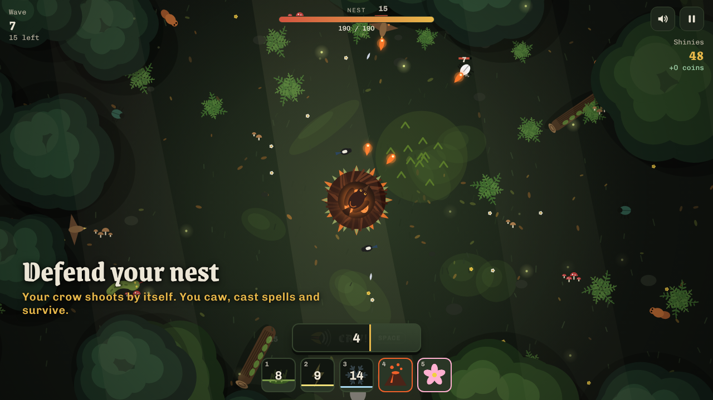
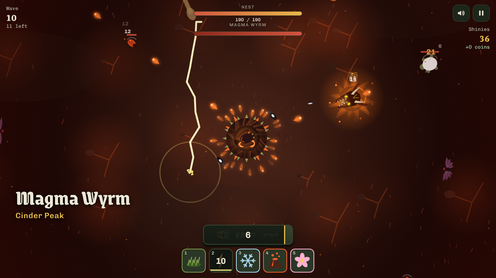
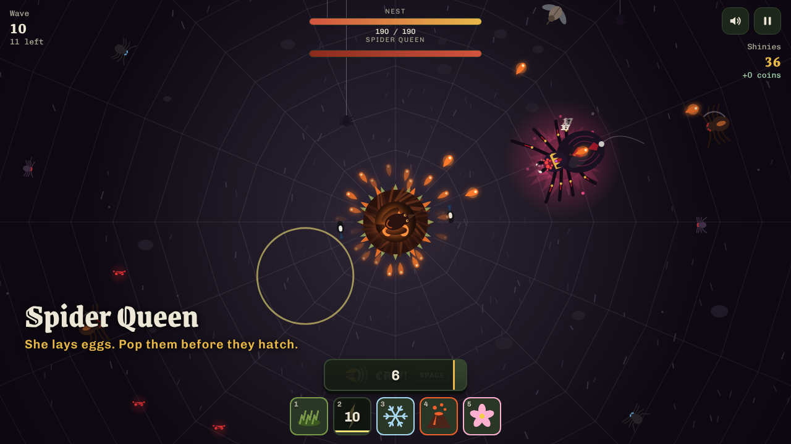
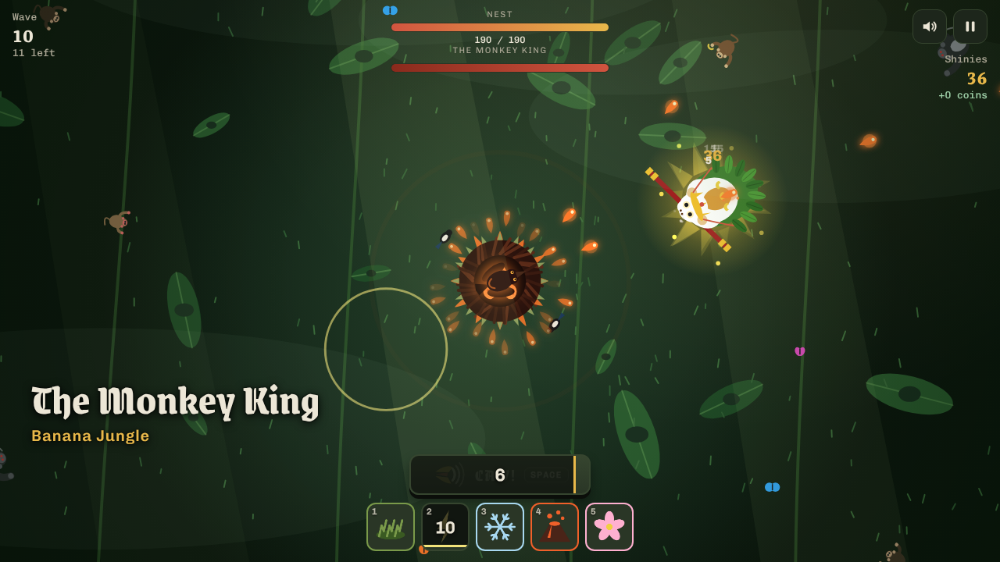
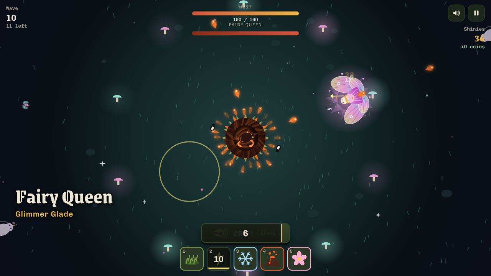
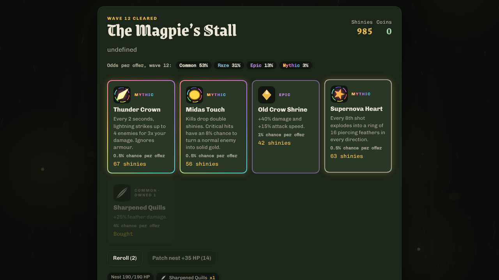
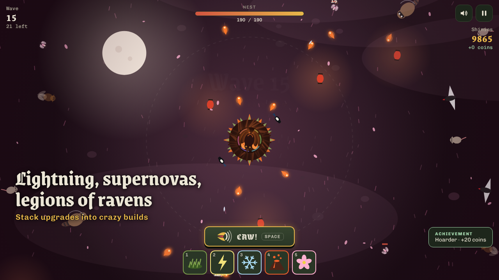
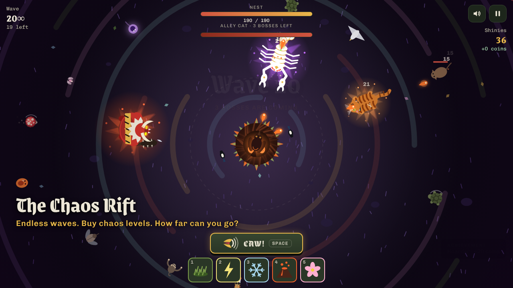
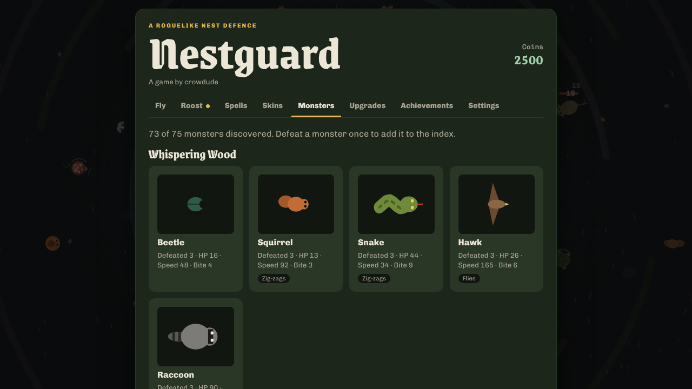

# Nestguard

A roguelike nest defence game by crowdude. You are a crow, and everything in the forest wants your eggs.

▶ **[Watch the trailer in full quality (MP4)](media/trailer.mp4)**

## What's in the game

- Hold the nest against waves of monsters. Your crow shoots by itself; press **Space** (or tap the field) to caw.
- Shop between waves for random upgrades: common, rare, epic and wild **mythic** ones like the Thunder Crown and Raven Legion.
- 13 biomes, from Whispering Wood to The Void, plus a secret DLC office. Each has its own monsters, weather and a boss on wave 10, with 3 challenge runs per biome.
- The **Chaos Rift**: an endless mode with monsters and bosses from every biome, and 10 chaos levels you buy with coins.
- Pick up to 5 spells to take into each run. Every crow skin has its own passive, projectile, nest and caw.
- Spend coins in the Roost on permanent upgrades. Fill the monster and upgrade index, and unlock skins and achievements.
- Plays in English, French, Spanish and German.

## Screenshots

| | |
|---|---|
|  |  |
|  |  |
|  |  |
|  |  |
|  |  |

## Play

- **In a browser:** open `index.html`.
- **Installed on your computer:** download the installer for your system from the [Releases](../../releases) page.

| System | File |
|---|---|
| Windows | `Nestguard-<version>-win-x64.exe` |
| macOS | `Nestguard-<version>-mac-universal.dmg` |
| Linux | `Nestguard-<version>-linux-x86_64.AppImage` |

The installers are not code-signed. On Windows, click **More info → Run anyway** if SmartScreen warns. On macOS, right-click the app and choose **Open** the first time.

## Make a release

GitHub Actions builds the three installers and publishes them on a release by itself whenever the game or the desktop app changes on `main`. The release is named after the `version` in `desktop/package.json` (for example `v1.0.0`):

- Change that version (to `1.0.1`, `1.1.0` and so on) to make a new release.
- Leave it the same and the existing release gets the new installers.

Pushing a tag such as `v1.2.0` also builds a release with that name. You can run the **Nestguard installers** workflow by hand from the Actions tab to get the installers without making a release.

## Project layout

- `index.html` is the whole game: one file, no images or libraries.
- `media/` holds the trailer and screenshots used in this README.
- `desktop/` packages the game as a desktop app with Electron (`npm install`, then `npm start` to play or `npm run dist` to build an installer).
- `.github/workflows/nestguard-installers.yml` builds the installers.
